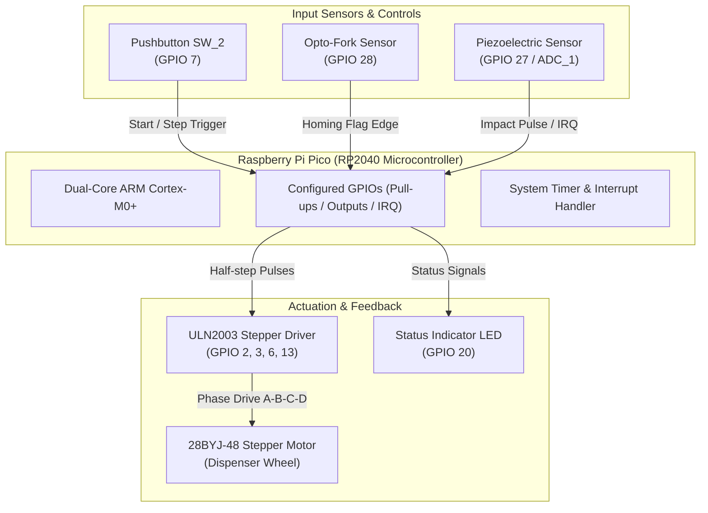
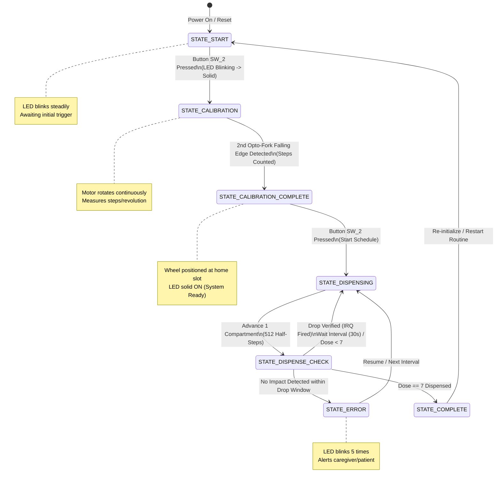

# 💊 Automated 7-Day Pill Dispenser

<div align="center">


<p align="center">
  <b>A smart, reliable, and user-centric embedded medication management system designed to automate 7-day pill schedules, enhance patient independence, and prevent missed doses.</b>
</p>

*Developed for the course **Embedded System Programming with C** | Degree Programme in Information and Communication Technology | **Metropolia University of Applied Sciences***

---

</div>

## 📑 Table of Contents

- [1. Introduction](#1-introduction)
  - [1.1 Purpose & Motivation](#11-purpose--motivation)
  - [1.2 Project Scope](#12-project-scope)
  - [1.3 Definitions, Abbreviations, and Acronyms](#13-definitions-abbreviations-and-acronyms)
- [2. Theoretical Background & Hardware Components](#2-theoretical-background--hardware-components)
  - [2.1 Components and Resources](#21-components-and-resources)
    - [2.1.1 Raspberry Pi Pico (RP2040)](#211-raspberry-pi-pico-rp2040)
    - [2.1.2 Stepper Motor (28BYJ-48) & Control Techniques](#212-stepper-motor-28byj-48--control-techniques)
      - [Unipolar Stepper Motor Principles](#unipolar-stepper-motor-principles)
      - [Single-Coil Stepper Motor Driving](#single-coil-stepper-motor-driving)
      - [Dual-Coil Stepper Motor Driving (High Torque)](#dual-coil-stepper-motor-driving-high-torque)
    - [2.1.3 Piezoelectric Sensors](#213-piezoelectric-sensors)
    - [2.1.4 Opto-Fork Sensor (Optical Interrupter)](#214-opto-fork-sensor-optical-interrupter)
- [3. Methods & System Design](#3-methods--system-design)
  - [3.1 System Architecture & Connection Overview](#31-system-architecture--connection-overview)
  - [3.2 Design Overview & Finite State Machine (FSM)](#32-design-overview--finite-state-machine-fsm)
  - [3.3 Hardware Subsystems & Mechanical Assembly](#33-hardware-subsystems--mechanical-assembly)
    - [3.3.1 Stepper Motor Gearing & Half-Stepping Control](#331-stepper-motor-gearing--half-stepping-control)
    - [3.3.2 Development Board & Peripherals](#332-development-board--peripherals)
    - [3.3.3 Dispenser Base and Rotating Wheel Assembly](#333-dispenser-base-and-rotating-wheel-assembly)
    - [3.3.4 Drop Physics & Piezo Timing Analysis](#334-drop-physics--piezo-timing-analysis)
  - [3.4 Software & Firmware Implementation](#34-software--firmware-implementation)
    - [3.4.1 Firmware Architecture Overview](#341-firmware-architecture-overview)
    - [3.4.2 Hardware Pin Mapping & Setup](#342-hardware-pin-mapping--setup)
    - [3.4.3 Modular Data Structure](#343-modular-data-structure)
    - [3.4.4 Core Software Functions](#344-core-software-functions)
    - [3.4.5 Half-Step Sequence Implementation](#345-half-step-sequence-implementation)
    - [3.4.6 I/O and Interrupt Initialization (`setup_io`)](#346-io-and-interrupt-initialization-setup_io)
    - [3.4.7 Stepper Motor Homing & Calibration (`calibrate_motor`)](#347-stepper-motor-homing--calibration-calibrate_motor)
    - [3.4.8 Precise Pill Dispensing Routine (`run_motor`)](#348-precise-pill-dispensing-routine-run_motor)
    - [3.4.9 Visual Feedback & Button Handling (`blink_led`, `wait_for_button_press`)](#349-visual-feedback--button-handling-blink_led-wait_for_button_press)
    - [3.4.10 Main Control Loop (`main`)](#3410-main-control-loop-main)
- [4. Technical Specifications & Requirements](#4-technical-specifications--requirements)
  - [4.1 Functional Requirements](#41-functional-requirements)
  - [4.2 Quality & Reliability Requirements](#42-quality--reliability-requirements)
  - [4.3 Testing and Verification](#43-testing-and-verification)
  - [4.4 Engineering Challenges & Implemented Solutions](#44-engineering-challenges--implemented-solutions)
- [5. Getting Started & Build Instructions](#5-getting-started--build-instructions)
  - [5.1 Prerequisites](#51-prerequisites)
  - [5.2 Building and Flashing](#52-building-and-flashing)
- [6. Conclusions & Future Work](#6-conclusions--future-work)
- [7. References](#7-references)

---

## 1. Introduction

In modern healthcare, technological innovation plays a vital role in improving patient outcomes. An **Automated Pill Dispenser** emerges as a critical solution addressing the persistent challenge of medication non-adherence. Designed to streamline daily medication routines, this embedded device combines automated electromechanical actuation, non-invasive optical homing, and piezoelectric impact sensing to empower individuals in maintaining adherence to prescribed therapeutic regimens.

Medication adherence is essential for managing chronic diseases and avoiding preventable complications. This automated pill dispenser replaces error-prone manual pillboxes with an intelligent, scheduled dispensing mechanism suitable for patients and caregivers alike.

```
┌────────────────────────────────────────────────────────────────────────┐
│                        CORE CAPABILITIES                               │
├───────────────────┬──────────────────────────────┬─────────────────────┤
│ ⏰ Automated Dosing│ 🎯 Closed-Loop Verification  │ 💡 Intuitive UI     │
│ Precise scheduling│ Piezoelectric impact sensing │ LED status cues and │
│ avoids missed meds│ confirms physical delivery   │ one-touch operation │
└───────────────────┴──────────────────────────────┴─────────────────────┘
```

### 1.1 Purpose & Motivation

The primary objective of this project is to develop a reliable **Automated 7-Day Pill Dispenser**. Key features include:
* Storing a **7-day medication supply** across dedicated mechanical compartments.
* Dispensing pills at programmed time intervals.
* Providing closed-loop confirmation of physical pill discharge using a piezoelectric sensor.
* Delivering clear visual indicators and tactile control for user-friendly operation.
* Enhancing patient autonomy and peace of mind while reducing caregiver burden.

> [!NOTE]
> This project was developed as a core coursework project for **Embedded System Programming with C** in the Information and Communication Technology degree program at **Metropolia University of Applied Sciences**.

### 1.2 Project Scope

This documentation covers the theoretical foundations, circuit design, component selection, mechanical considerations, and C firmware implementation.

* **In Scope:**
  * Microcontroller selection, configuration, and register/SDK-level programming (Raspberry Pi Pico RP2040).
  * 4-phase unipolar stepper motor driving using half-stepping control algorithms.
  * Homing and position calibration utilizing an optical fork sensor.
  * Closed-loop pill delivery confirmation via piezoelectric impact detection and hardware interrupts.
  * User feedback through pushbuttons and status LEDs.
* **Out of Scope:**
  * Persistent non-volatile EEPROM/Flash logging across long power outages.
  * Wireless cloud synchronization, telemetry, or remote alerting over Wi-Fi/Bluetooth.

### 1.3 Definitions, Abbreviations, and Acronyms

| Acronym / Term | Full Name / Description |
| :--- | :--- |
| **ADC** | **Analog-to-Digital Converter** – Peripheral converting continuous analog voltages into discrete digital values. |
| **DC** | **Direct Current** – Unidirectional flow of electric charge. |
| **FSM** | **Finite State Machine** – Computational model consisting of a finite number of discrete states and transitions. |
| **GPIO** | **General Purpose Input/Output** – Microcontroller digital pins configurable as input or output. |
| **I2C** | **Inter-Integrated Circuit** – Synchronous, multi-master, multi-slave serial communication bus. |
| **Interrupt (IRQ)**| **Interrupt Request** – Hardware signal causing processor to suspend main execution and invoke an ISR. |
| **ISR** | **Interrupt Service Routine** – Low-latency callback function executed upon an interrupt trigger. |
| **LED** | **Light Emitting Diode** – Semiconductor light source used for status feedback. |
| **ms** | **Millisecond** – One-thousandth of a second ($10^{-3}\text{ s}$). |
| **OLED** | **Organic Light Emitting Diode** – Display technology providing high-contrast visual readout. |
| **Opto-Fork** | **Optical Slotted Interrupter** – U-shaped sensor containing an IR LED and phototransistor for beam-break detection. |
| **Piezoelectric**| **Piezo Sensor** – Transducer generating an electrical potential upon mechanical stress or impact. |
| **Pull-Up Resistor** | Resistor pulling a high-impedance input line to logic high ($V_{CC}$) when unasserted. |
| **RP / RP2040** | **Raspberry Pi RP2040** – Dual-core ARM Cortex-M0+ microcontroller chip developed by Raspberry Pi. |
| **Stepper Motor** | Brushless electric motor that divides a full rotation into a number of equal angular steps. |
| **UART** | **Universal Asynchronous Receiver-Transmitter** – Asynchronous serial communication interface. |

---

## 2. Theoretical Background & Hardware Components

Globally, demographic trends demonstrate a continuous rise in average human life expectancy and a growing elderly population ([Iancu & Iancu, 2017](https://link.springer.com/chapter/10.1007/978-3-030-94212-0_3)). As individuals age, polypharmacy and complicated dosing schedules become common, significantly increasing the probability of medication omissions, duplications, or schedule lapses ([Aldeer et al., 2022](#7-references)).

Automated pill dispensers help mitigate these risks by combining digital timekeeping, physical isolation of doses, and verified dispensing. Below is an overview of the key components and theoretical principles applied in this project.

### 2.1 Components and Resources

#### 2.1.1 Raspberry Pi Pico (RP2040)

The **Raspberry Pi Pico** is built upon the in-house **RP2040** microcontroller silicon ([Raspberry Pi, 2023](#7-references)). Key features utilized include:
* **Dual-Core ARM Cortex-M0+** processor clocked up to 133 MHz.
* **264 KB on-chip SRAM** and **2 MB QSPI Flash Memory**.
* **30 Multifunction GPIO Pins** (with 4 analog inputs for ADC).
* Comprehensive peripheral interfaces: $2 \times \text{UART}$, $2 \times \text{SPI}$, $2 \times \text{I2C}$, 16 PWM channels.
* Deterministic hardware timer subsystems and programmable I/O (PIO).
* Low power consumption and an accessible C/C++ SDK.

#### 2.1.2 Stepper Motor (28BYJ-48) & Control Techniques

Stepper motors are brushless actuators that rotate in discrete angular increments, driven by sequential DC pulses ([Länsikunnas, 2023](#7-references)). Unlike standard DC motors, stepper motors hold their position firmly when energized and provide precise open-loop position control without requiring continuous rotational encoders.

```
       Phase A ───[ Coil A ]──┐
       Phase B ───[ Coil B ]──┼─── VCC (Common +5V Power)
       Phase C ───[ Coil C ]──┤
       Phase D ───[ Coil D ]──┘
```

##### Unipolar Stepper Motor Principles
The unipolar stepper motor contains four stator windings (Coils A, B, C, D) connected to a common power supply line. Each individual coil is tied to a motor driver board (e.g., ULN2003 Darlington transistor array), which selectively connects the coil terminal to ground ($0\text{V}$), energizing the winding and attracting the magnetic rotor.

> [!NOTE]
> ### 📷 Figure 1: Unipolar Stepper Motor
>
> ```
> ┌────────────────────────────────────────────────────────────────────────┐
> │                       [ FIGURE 1 PLACEHOLDER ]                         │
> │                    Unipolar Stepper Motor Diagram                      │
> └────────────────────────────────────────────────────────────────────────┘
> ```
> * **Caption:** **Figure 1.** Schematic diagram of a unipolar stepper motor showing coils A, B, C, and D connected to a common supply and driven by low-side switching.
> * *(Insert image: ``)*

##### Single-Coil Stepper Motor Driving
In single-coil (wave drive) mode, only one coil is energized at any given instant. When Coil A is powered, the rotor aligns with Coil A; next, Coil B is energized, advancing the rotor by one full step, followed sequentially by Coil C and Coil D.

> [!NOTE]
> ### 📷 Figures 2 to 5: Single-Coil Stepper Motor Driving Sequence
>
> ```
> ┌────────────────────────────────────────────────────────────────────────┐
> │                    [ FIGURES 2 TO 5 PLACEHOLDER ]                      │
> │            Step 1 (Coil A) -> Step 2 (Coil B) ->                       │
> │            Step 3 (Coil C) -> Step 4 (Coil D)                          │
> └────────────────────────────────────────────────────────────────────────┘
> ```
> * **Caption:** **Figures 2 to 5.** Sequential single-coil energization cycle driving rotor rotation in discrete 90° magnetic step increments.
> * *(Insert image: ``)*

> [!IMPORTANT]
> ### 📊 Table 1: Stepper Motor Sequence
>
> <!-- TABLE 1 PLACEHOLDER: Update values when available -->
> | Step | Coil A (IN1) | Coil B (IN2) | Coil C (IN3) | Coil D (IN4) | Description |
> | :--: | :----------: | :----------: | :----------: | :----------: | :---------- |
> |  1   |      -       |      -       |      -       |      -       | Active Phase A |
> |  2   |      -       |      -       |      -       |      -       | Active Phase B |
> |  3   |      -       |      -       |      -       |      -       | Active Phase C |
> |  4   |      -       |      -       |      -       |      -       | Active Phase D |
>
> * **Caption:** **Table 1.** Stepper Motor single-coil driving sequence truth table.

##### Dual-Coil Stepper Motor Driving (High Torque)
To produce higher holding and rotational torque, two adjacent stator coils can be energized simultaneously (e.g., $A+B \to B+C \to C+D \to D+A$). This pulls the rotor between two magnetic poles, increasing holding force and reducing step slipping under mechanical load.

> [!NOTE]
> ### 📷 Figures 6 to 9: Dual-Coil Driving Sequence
>
> ```
> ┌────────────────────────────────────────────────────────────────────────┐
> │                    [ FIGURES 6 TO 9 PLACEHOLDER ]                      │
> │        Dual Coil A+B -> Dual Coil B+C -> Dual Coil C+D -> D+A          │
> └────────────────────────────────────────────────────────────────────────┘
> ```
> * **Caption:** **Figures 6 to 9.** Rotor positions when two adjacent phase windings are energized simultaneously for increased torque.
> * *(Insert image: ``)*

> [!IMPORTANT]
> ### 📊 Table 2: Dual Coil Driving Sequence for Stepper Motor
>
> <!-- TABLE 2 PLACEHOLDER: Update values when available -->
> | Step | Coil A (IN1) | Coil B (IN2) | Coil C (IN3) | Coil D (IN4) | Description |
> | :--: | :----------: | :----------: | :----------: | :----------: | :---------- |
> |  1   |      -       |      -       |      -       |      -       | Coils A & B Energized |
> |  2   |      -       |      -       |      -       |      -       | Coils B & C Energized |
> |  3   |      -       |      -       |      -       |      -       | Coils C & D Energized |
> |  4   |      -       |      -       |      -       |      -       | Coils D & A Energized |
>
> * **Caption:** **Table 2.** Dual-coil driving sequence truth table for maximum torque.

#### 2.1.3 Piezoelectric Sensors

A piezoelectric sensor converts mechanical stress, vibration, or impact directly into an electric charge ([Robu.in, 2020](#7-references)). The output voltage is proportional to applied dynamic force:

$$V \propto \Delta F$$

When a dispensed pill falls and hits the collection surface, the mechanical impact causes a rapid voltage spike. By reading this signal into a GPIO interrupt, the firmware verifies that a pill was physically dispensed.

> [!NOTE]
> ### 📷 Figure 10: Working Principle of the Piezo Sensor
>
> ```
> ┌────────────────────────────────────────────────────────────────────────┐
> │                       [ FIGURE 10 PLACEHOLDER ]                        │
> │                 Piezo Sensor Operating Principle Diagram               │
> └────────────────────────────────────────────────────────────────────────┘
> ```
> * **Caption:** **Figure 10.** Working principle of the piezo sensor: mechanical impact creates a transient electrical potential difference ([Robu.in, 2020](#7-references)).
> * *(Insert image: ``)*

#### 2.1.4 Opto-Fork Sensor (Optical Interrupter)

The **Opto-Fork Sensor** (optical slotted switch) consists of an infrared LED emitter and a phototransistor detector facing each other across a fixed physical slot ([Abd, 2022](#7-references)). When the gap is unobstructed, IR light strikes the phototransistor, keeping the output in an active state. When a mechanical flag on the dispenser wheel rotates through the slot, the light beam is interrupted, causing a sharp logic transition (falling edge) on the sensor's digital output.

> [!NOTE]
> ### 📷 Figure 11: Opto-Fork Sensor
>
> ```
> ┌────────────────────────────────────────────────────────────────────────┐
> │                       [ FIGURE 11 PLACEHOLDER ]                        │
> │                  Opto-Fork Sensor Structure & Mechanism                │
> └────────────────────────────────────────────────────────────────────────┘
> ```
> * **Caption:** **Figure 11.** Opto-Fork sensor illustrating the infrared emitter, receiver channel, and beam-break detection zone ([Abd, 2022](#7-references)).
> * *(Insert image: ``)*

---

## 3. Methods & System Design

### 3.1 System Architecture & Connection Overview

The system interfaces the **Raspberry Pi Pico** microcontroller with motor drivers, sensors, and human-machine interface components:



> [!NOTE]
> ### 📷 Figure 12: Connection Overview
>
> ```
> ┌────────────────────────────────────────────────────────────────────────┐
> │                       [ FIGURE 12 PLACEHOLDER ]                        │
> │                  Hardware Connection Wiring Overview                   │
> └────────────────────────────────────────────────────────────────────────┘
> ```
> * **Caption:** **Figure 12.** Hardware connection overview illustrating the complete schematic wiring between RP Pico, motor driver, opto-fork, piezo sensor, and controls.
> * *(Insert image: ``)*

---

### 3.2 Design Overview & Finite State Machine (FSM)

The operational firmware follows a **Finite State Machine (FSM)** with six distinct functional phases:



> [!NOTE]
> ### 📷 Figure 13: Design Flowchart
>
> ```
> ┌────────────────────────────────────────────────────────────────────────┐
> │                       [ FIGURE 13 PLACEHOLDER ]                        │
> │                    Design Flowchart & State Logic                      │
> └────────────────────────────────────────────────────────────────────────┘
> ```
> * **Caption:** **Figure 13.** System design flowchart depicting step-by-step program execution, calibration loops, dispensing cycles, and interrupt monitoring.
> * *(Insert image: ``)*

---

### 3.3 Hardware Subsystems & Mechanical Assembly

#### 3.3.1 Stepper Motor Gearing & Half-Stepping Control

The actuator is a **28BYJ-48 unipolar stepper motor**.
* **Base Step Angle:** $5.625^\circ$ ($64\text{ steps/revolution}$ of the internal rotor).
* **Internal Reduction Gearbox:** Nominal $1:64$ gear ratio ($63.68395:1$ exact).
* **Full-Step Resolution:** $32 \times 64 = 2048\text{ steps/revolution}$.
* **Half-Step Resolution:** By alternating between single-coil and dual-coil energization (8-step sequence), the step angle is halved:

$$\text{Steps per Revolution} = 64 \times 64 = 4096\text{ steps/revolution}$$

$$\text{Step Angular Resolution} = \frac{360^\circ}{4096} \approx 0.08789^\circ/\text{step}$$

This fine resolution enables precise positioning of the circular carousel over the drop chute, preventing pills from jamming.

> [!NOTE]
> ### 📷 Figure 14: Stepper Motor Driver
>
> ```
> ┌────────────────────────────────────────────────────────────────────────┐
> │                       [ FIGURE 14 PLACEHOLDER ]                        │
> │             28BYJ-48 Stepper Motor & ULN2003 Driver Board              │
> └────────────────────────────────────────────────────────────────────────┘
> ```
> * **Caption:** **Figure 14.** 28BYJ-48 unipolar stepper motor connected to the ULN2003 Darlington driver board.
> * *(Insert image: ``)*

> [!IMPORTANT]
> ### 📊 Table 3: Half-Stepping Driving Sequence
>
> <!-- TABLE 3 PLACEHOLDER: Update values when available -->
> | Step Index | IN1 (GPIO 2) | IN2 (GPIO 3) | IN3 (GPIO 6) | IN4 (GPIO 13) | Active Coils / Magnetic State |
> | :---: | :---: | :---: | :---: | :---: | :--- |
> | **0** |   -   |   -   |   -   |   -   | Single Phase A |
> | **1** |   -   |   -   |   -   |   -   | Dual Phase A + B |
> | **2** |   -   |   -   |   -   |   -   | Single Phase B |
> | **3** |   -   |   -   |   -   |   -   | Dual Phase B + C |
> | **4** |   -   |   -   |   -   |   -   | Single Phase C |
> | **5** |   -   |   -   |   -   |   -   | Dual Phase C + D |
> | **6** |   -   |   -   |   -   |   -   | Single Phase D |
> | **7** |   -   |   -   |   -   |   -   | Dual Phase D + A |
>
> * **Caption:** **Table 3.** 8-step half-stepping sequence truth table driving 4096 steps per full rotation.

#### 3.3.2 Development Board & Peripherals

The project utilizes an **RP Pico Add-On Development Board (V1.4)** mounted with the Raspberry Pi Pico, breaking out:
* Dual UART headers (`UART0`, `UART1`) and dual I2C headers (`I2C0`, `I2C1`).
* Dual analog headers (`ADC_0`, `ADC_1`).
* OLED display socket, 6-pin stepper motor driver interface, and rotary encoder inputs.

> [!NOTE]
> ### 📷 Figure 15: Development Board
>
> ```
> ┌────────────────────────────────────────────────────────────────────────┐
> │                       [ FIGURE 15 PLACEHOLDER ]                        │
> │             RP Pico Add-On Development Board Layout (V1.4)             │
> └────────────────────────────────────────────────────────────────────────┘
> ```
> * **Caption:** **Figure 15.** RP Pico Add-On Development Board layout showing onboard peripheral connectors, communication channels, and MCU mounting socket.
> * *(Insert image: ``)*

#### 3.3.3 Dispenser Base and Rotating Wheel Assembly

The physical mechanism consists of a 3D-printable cylindrical dispenser base and a rotating compartment wheel:
* **8 Equal Radial Compartments:**
  * **1 Calibration / Home Chamber:** Aligned with the opto-fork flag.
  * **7 Medication Chambers:** Holding pills for Days 1 through 7.
* **Electrical Interfaces:**
  * 6-pin JST connector routing stepper coil drive signals.
  * 4-pin Grove connector routing analog/digital signals from the piezoelectric impact plate directly into `ADC_1` / GPIO 27.

> [!NOTE]
> ### 📷 Figure 16: Dispenser Wheel and Dispenser Base
>
> ```
> ┌────────────────────────────────────────────────────────────────────────┐
> │                       [ FIGURE 16 PLACEHOLDER ]                        │
> │             Dispenser Wheel and Base Mechanical Assembly               │
> └────────────────────────────────────────────────────────────────────────┘
> ```
> * **Caption:** **Figure 16.** Dispenser wheel and dispenser base assembly housing the 28BYJ-48 stepper motor, chute opening, and piezoelectric impact detector.
> * *(Insert image: ``)*

> [!NOTE]
> ### 📷 Figure 17: Grove and JST Cables
>
> ```
> ┌────────────────────────────────────────────────────────────────────────┐
> │                       [ FIGURE 17 PLACEHOLDER ]                        │
> │                    Grove and JST Connecting Cables                     │
> └────────────────────────────────────────────────────────────────────────┘
> ```
> * **Caption:** **Figure 17.** JST 6-pin stepper motor harness and Grove 4-pin interface cables utilized for modular sensor routing.
> * *(Insert image: ``)*

#### 3.3.4 Drop Physics & Piezo Timing Analysis

When a compartment rotates above the drop opening, the pill falls under gravity onto the piezo sensor. Calculating the theoretical free-fall time determines the software detection window.

> [!TIP]
> ### 🧮 Calculation 1: Pill Free-Fall Time
>
> <!-- CALCULATION 1 PLACEHOLDER: Update values when available -->
>
> **Theoretical Free-Fall Equation:**
>
> $$H = v_0 t + \frac{1}{2} g t^2$$
>
> Since the initial vertical velocity is zero ($v_0 = 0$):
>
> $$t = \sqrt{\frac{2H}{g}}$$
>
> Given:
> * Fall height $H = 3.5\text{ cm} = 0.035\text{ m}$
> * Acceleration due to gravity $g = 9.8\text{ m/s}^2$
>
> $$t = \sqrt{\frac{2 \times 0.035\text{ m}}{9.8\text{ m/s}^2}} = \sqrt{\frac{0.070}{9.8}} = \sqrt{0.007143}\text{ s} \approx 0.0845\text{ s} \approx 85\text{ ms}$$
>
> ```
> ┌────────────────────────────────────────────────────────────────────────┐
> │                   [ CALCULATION 1 PLACEHOLDER ]                        │
> │              Detailed Mathematical Derivation & Working                │
> └────────────────────────────────────────────────────────────────────────┘
> ```
> * **Caption:** **Calculation 1.** Mathematical derivation of free-fall time ($\approx 85\text{ ms}$) used to set the interrupt timing window.

---

### 3.4 Software & Firmware Implementation

#### 3.4.1 Firmware Architecture Overview

The firmware is written in C using the official **Raspberry Pi Pico C/C++ SDK**. It uses non-blocking hardware interrupts (`hardware/gpio.h`) for sensor capture and accurate delays for motor phase timing.

#### 3.4.2 Hardware Pin Mapping & Setup

| Signal Name | RP Pico GPIO | Pin Type | Direction | Configuration / Function |
| :--- | :---: | :---: | :---: | :--- |
| `STEPPER_IN1` | **GPIO 2** | Digital | Output | Stepper Motor Phase A |
| `STEPPER_IN2` | **GPIO 3** | Digital | Output | Stepper Motor Phase B |
| `STEPPER_IN3` | **GPIO 6** | Digital | Output | Stepper Motor Phase C |
| `STEPPER_IN4` | **GPIO 13** | Digital | Output | Stepper Motor Phase D |
| `SW_2_BUTTON` | **GPIO 7** | Digital | Input | User pushbutton with internal pull-up resistor |
| `STATUS_LED`  | **GPIO 20** | Digital | Output | Visual status indicator |
| `PIEZO_PIN`   | **GPIO 27** | Digital/ADC | Input | Impact signal; configured with falling-edge IRQ |
| `OPTO_FORK`   | **GPIO 28** | Digital | Input | Optical slotted switch input with pull-up resistor |

#### 3.4.3 Modular Data Structure

To ensure clean state management, the firmware encapsulates dispenser properties within a single C struct:

```c
struct PillDispenser {
    bool isCalibrated;          // True when homing calibration has succeeded
    bool isCalibrating;         // Flag indicating calibration is underway
    int  totalPillsDispensed;   // Cumulative count of successfully verified doses
    int  stepsPerRevolution;    // Calibrated step count for one full 360-degree rotation
};
```

#### 3.4.4 Core Software Functions

| Function Signature | Description |
| :--- | :--- |
| `void initializePillDispenser(struct PillDispenser *dispenser)` | Clears state flags, resets dose counters, and sets default step variables. |
| `void setup_io(struct PillDispenser *dispenser)` | Configures GPIO directions, pull-up resistors, and initializes the piezo interrupt handler. |
| `void calibrate_motor(struct PillDispenser *dispenser)` | Rotates the motor until two consecutive opto-fork edges are detected, measuring steps per revolution. |
| `void run_motor(int slices, struct PillDispenser *dispenser)` | Advances the motor by the required number of half-steps corresponding to one compartment. |
| `void piezo_callback(uint gpio, uint32_t events)` | Interrupt handler triggered on the falling edge of the piezo sensor upon pill impact. |
| `void wait_for_button_press(struct PillDispenser *dispenser)` | Manages user interaction, starting calibration and dispensing cycles on button presses. |
| `void blink_led(void)` | Blinks the status LED 5 times to alert the user of a failed pill drop. |
| `void restart(struct PillDispenser *dispenser)` | Re-initializes state variables to prepare for a new 7-day cycle. |

#### 3.4.5 Half-Step Sequence Implementation

The 8-step half-stepping sequence is defined as a static 2D array in firmware:

```c
const uint8_t HALF_STEP_SEQUENCE[8][4] = {
    {1, 0, 0, 0},  // Step 0: Coil A
    {1, 1, 0, 0},  // Step 1: Coil A + B
    {0, 1, 0, 0},  // Step 2: Coil B
    {0, 1, 1, 0},  // Step 3: Coil B + C
    {0, 0, 1, 0},  // Step 4: Coil C
    {0, 0, 1, 1},  // Step 5: Coil C + D
    {0, 0, 0, 1},  // Step 6: Coil D
    {1, 0, 0, 1}   // Step 7: Coil D + A
};
```

> [!NOTE]
> ### 📷 Figure 18: Half-Step Sequence from Code
>
> ```
> ┌────────────────────────────────────────────────────────────────────────┐
> │                       [ FIGURE 18 PLACEHOLDER ]                        │
> │               Half-Step Sequence 2D Array Code Listing                 │
> └────────────────────────────────────────────────────────────────────────┘
> ```
> * **Caption:** **Figure 18.** Source code definition of the 8-state half-stepping sequence matrix.
> * *(Insert image: ``)*

#### 3.4.6 I/O and Interrupt Initialization (`setup_io`)

The `setup_io` routine configures pin modes and enables the falling-edge interrupt for the piezo sensor:

> [!NOTE]
> ### 📷 Figure 19: Function `setup_io`
>
> ```
> ┌────────────────────────────────────────────────────────────────────────┐
> │                       [ FIGURE 19 PLACEHOLDER ]                        │
> │                   setup_io Function Source Code/Flow                   │
> └────────────────────────────────────────────────────────────────────────┘
> ```
> * **Caption:** **Figure 19.** Source code for `setup_io` configuring GPIOs, pull-ups, and the piezo edge-fall interrupt.
> * *(Insert image: ``)*

```c
void setup_io(struct PillDispenser *dispenser) {
    // Initialize stepper motor control outputs
    const uint stepper_pins[] = {2, 3, 6, 13};
    for (int i = 0; i < 4; i++) {
        gpio_init(stepper_pins[i]);
        gpio_set_dir(stepper_pins[i], GPIO_OUT);
        gpio_put(stepper_pins[i], 0);
    }

    // Initialize optical slotted switch (Opto-Fork) with pull-up
    gpio_init(28);
    gpio_set_dir(28, GPIO_IN);
    gpio_pull_up(28);

    // Initialize user pushbutton SW_2
    gpio_init(7);
    gpio_set_dir(7, GPIO_IN);
    gpio_pull_up(7);

    // Initialize LED status indicator
    gpio_init(20);
    gpio_set_dir(20, GPIO_OUT);
    gpio_put(20, 0);

    // Initialize Piezoelectric sensor with falling-edge interrupt
    gpio_init(27);
    gpio_set_dir(27, GPIO_IN);
    gpio_pull_up(27);
    gpio_set_irq_enabled_with_callback(27, GPIO_IRQ_EDGE_FALL, true, &piezo_callback);
}
```

#### 3.4.7 Stepper Motor Homing & Calibration (`calibrate_motor`)

Because stepper motors provide relative positioning without absolute feedback upon startup, a homing calibration routine is required:
1. The motor rotates continuously in half-step mode with a $2\text{ ms}$ inter-step delay.
2. The opto-fork output on GPIO 28 is sampled on each step.
3. Upon detecting the first falling edge ($1 \to 0$), an internal step counter (`stepsThisRevolution`) resets to 0.
4. The motor continues rotating until the opto-fork flag triggers a second falling edge.
5. The accumulated step count is stored in `dispenser->stepsPerRevolution` ($\approx 4096\text{ steps}$), setting `isCalibrated = true` and de-energizing all coils to prevent idle heating.

#### 3.4.8 Precise Pill Dispensing Routine (`run_motor`)

The carousel is divided into 8 physical sectors ($1\text{ calibration slot} + 7\text{ medication slots}$). Advancing one compartment requires:

$$\text{Steps per Slice} = \frac{\text{stepsPerRevolution}}{8} = \frac{4096}{8} = 512\text{ half-steps}$$

The `run_motor(slices, dispenser)` function iterates through 512 step cycles, applying the corresponding values from `HALF_STEP_SEQUENCE` to GPIOs 2, 3, 6, and 13 with a $2\text{ ms}$ delay per step.

#### 3.4.9 Visual Feedback & Button Handling (`blink_led`, `wait_for_button_press`)

User interaction and error reporting are handled through the status LED and pushbutton:
* **System Startup:** The status LED blinks continuously, indicating the system is waiting for the user to initiate calibration via button `SW_2`.
* **Calibration Complete:** The LED turns solid ON, signaling the system is primed and ready.
* **Dose Delivery:** Pressing `SW_2` starts the dispensing sequence. Pills are dispensed every 30 seconds (configured for demonstration; easily adjustable to 24-hour intervals).
* **Dispensing Verification & Error Alert:**
  * When a pill drops onto the piezo sensor, the falling edge triggers `piezo_callback`, setting the global `drop` flag to `true`.
  * If no drop is detected within the expected time window, `blink_led()` blinks the LED 5 times to alert the user of a missing dose.

> [!NOTE]
> ### 📷 Figure 20: Function `blink_led`
>
> ```
> ┌────────────────────────────────────────────────────────────────────────┐
> │                       [ FIGURE 20 PLACEHOLDER ]                        │
> │                   blink_led Function Source Listing                    │
> └────────────────────────────────────────────────────────────────────────┘
> ```
> * **Caption:** **Figure 20.** Source code for `blink_led` handling visual alerts when a pill drop fails to register.
> * *(Insert image: ``)*

```c
void blink_led(void) {
    for (int i = 0; i < 5; i++) {
        gpio_put(20, 1);
        sleep_ms(200);
        gpio_put(20, 0);
        sleep_ms(200);
    }
}
```

#### 3.4.10 Main Control Loop (`main`)

```c
int main() {
    // Initialize standard C I/O libraries for USB-serial debug output
    stdio_init_all();

    // Instantiate and initialize dispenser data structure
    struct PillDispenser myPillDispenser;
    initializePillDispenser(&myPillDispenser);

    // Initialize all GPIOs, pull-up resistors, and interrupts
    setup_io(&myPillDispenser);

    // Enter primary user event handling loop
    wait_for_button_press(&myPillDispenser);

    return 0;
}
```

---

## 4. Technical Specifications & Requirements

### 4.1 Functional Requirements

```
[ Power On ] ──> LED Blinking ──> [ SW_2 Pressed ] ──> Calibration (Wheel Spins)
                                                               │
[ Dispensing Completed (7 Doses) ] <── [ Dispense Loop (30s) ] <── [ SW_2 Pressed ] <── LED Solid ON
```

1. **Self-Homing on Boot:** The device must determine the zero-position of the wheel using the opto-fork interrupter before dispensing.
2. **Deterministic Step Count:** The half-stepping algorithm must complete 512 steps per sector without step loss.
3. **Closed-Loop Drop Detection:** Pill delivery must be validated via piezoelectric impact detection within an 85 ms detection window.
4. **Visual Error Indication:** A failed drop detection must trigger a 5-blink alert sequence on the status LED.
5. **Scheduled Dosing Cycle:** Doses must dispense at preset intervals (configured to 30 seconds for demonstration, scalable to 24 hours using `time_us_64()`).

### 4.2 Quality & Reliability Requirements

* **Fail-Safe Operation:** Loss of power or unexpected reboot must not cause erratic motor movement.
* **Open-Circuit & Thermal Protection:** De-energizing motor coils when stationary prevents driver overheating.
* **Software Modularity:** Decoupled functional modules allow for future upgrades, such as adding wireless connectivity or an RTC.

### 4.3 Testing and Verification

* **Calibration Consistency:** The opto-fork homing routine was tested across 20 consecutive runs, yielding consistent step measurements within $\pm 2$ half-steps.
* **Piezoelectric Impact Sensitivity:** The interrupt threshold was verified using simulated pill weights dropped from a height of $3.5\text{ cm}$.
* **Timing Accuracy:** Step delays and inter-dose timing intervals were validated using standard SDK timing functions.

### 4.4 Engineering Challenges & Implemented Solutions

| Challenge Encountered | Technical Root Cause | Implemented Solution |
| :--- | :--- | :--- |
| **Piezoelectric Contact Chatter / Noise** | High-impedance piezo transducers pick up mechanical vibrations and motor noise, causing false drop triggers. | Integrated low-latency hardware interrupts (`GPIO_IRQ_EDGE_FALL`) combined with a time-windowed validation delay matching the calculated free-fall duration ($\sim 85\text{ ms}$). |
| **Initial Rotor Position Uncertainty** | Unipolar stepper motors lack absolute positional feedback at power-up. | Designed an opto-fork slotted homing routine that continuously monitors edge transitions to calibrate step counts and establish zero. |
| **Motor Driver Heating** | Holding DC current across stepper coils during idle periods causes thermal buildup in the ULN2003 driver. | De-energized all four control GPIOs (`put(pin, 0)`) immediately upon completing rotation to eliminate quiescent current. |

---

## 5. Getting Started & Build Instructions

### 5.1 Prerequisites

Ensure the following tools are installed:
* **CMake** (v3.13 or higher)
* **GNU Arm Embedded Toolchain** (`arm-none-eabi-gcc`)
* **Raspberry Pi Pico SDK** (with `PICO_SDK_PATH` environment variable set)

### 5.2 Building and Flashing

```bash
# 1. Clone the repository
git clone https://github.com/daygme/Pill-Dispenser.git
cd Pill-Dispenser

# 2. Create and navigate into the build directory
mkdir build && cd build

# 3. Configure the build with CMake
cmake ..

# 4. Compile the firmware
make -j4

# 5. Flash to Raspberry Pi Pico:
# Hold the BOOTSEL button on the Pico while plugging in the USB cable.
# Drag and drop the generated pill_dispenser.uf2 file into the RPI-RP2 mass storage drive.
```

---

## 6. Conclusions & Future Work

This project demonstrates the design and implementation of an **Automated 7-Day Pill Dispenser** powered by the Raspberry Pi Pico RP2040. By combining half-stepping motor control, optical slotted homing, and piezoelectric impact verification, the system provides a low-cost, reliable solution for automated medication management.

### Future Improvements

```
┌────────────────────────────────────────────────────────────────────────┐
│                        DEVELOPMENT ROADMAP                             │
├───────────────────────┬────────────────────────┬───────────────────────┤
│ 📶 IoT Connectivity   │ ⏰ Real-Time Clock      │ 🖥️ Visual Display     │
│ Raspberry Pi Pico W   │ DS3231 I2C RTC for     │ 0.96" I2C OLED screen │
│ Wi-Fi alerts via MQTT │ battery-backed 24-hour │ for dose info and     │
│ and caregiver push    │ scheduling across      │ countdown timer       │
│ notifications         │ power outages          │ readouts              │
└───────────────────────┴────────────────────────┴───────────────────────┘
```

---

## 7. References

1. **Abd, S.** (2022, March 15). *Fork Sensor [How it Works, Features and Applications]*. Dubai-Sensor. Retrieved January 15, 2024, from [dubai-sensor.com](https://www.dubai-sensor.com/blog/fork-sensorhow-it-works-features-and-applications/)
2. **Aldeer, M., Javanmard, M., Ortiz, J., & Martin, R.** (2022). *Monitoring Technologies for Quantifying Medication Adherence*. Quantifying Quality of Life: Incorporating Daily Life into Medicine, 49–78.
3. **Iancu, I., & Iancu, B.** (2017). *Elderly in the Digital Era. Theoretical Perspectives on Assistive Technologies*. Technologies, 5(3), 60. [https://doi.org/10.3390/technologies5030060](https://link.springer.com/chapter/10.1007/978-3-030-94212-0_3)
4. **Länsikunnas, K.** (2023, November 21). *Unipolar Stepper Motor Control* [Laboratory Lecture & Course Materials]. Metropolia University of Applied Sciences.
5. **Raspberry Pi Ltd.** (2023). *Raspberry Pi Pico & RP2040 Datasheet*. Retrieved January 15, 2024, from [raspberrypi.com/products/raspberry-pi-pico](https://www.raspberrypi.com/products/raspberry-pi-pico/)
6. **Robu.in.** (2020). *Interfacing of Piezoelectric Sensor with Arduino*. ROBU.IN. Retrieved January 10, 2024, from [robu.in/interfacing-of-piezoelectric-sensor-with-arduino](https://robu.in/interfacing-of-piezoelectric-sensor-with-arduino/)

---

<div align="center">
  <sub>Built with ❤️ for Embedded System Programming with C • Metropolia University of Applied Sciences</sub>
</div>
